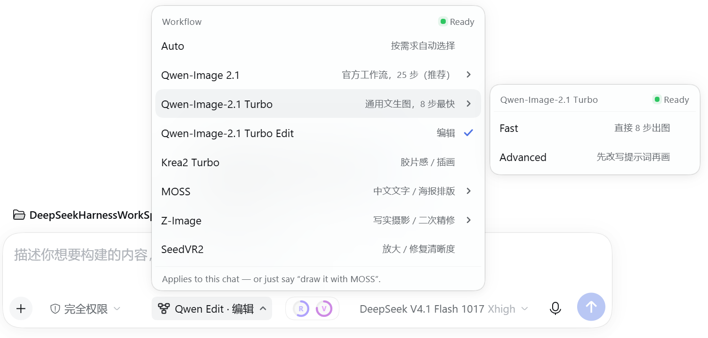

# dsh-comfyui-use

> Let **DeepSeek Harness** drive your local ComfyUI from the chat:
> pick a workflow in the composer, watch a drawing frame while it renders, and get the image inline.
> ComfyUI is started in the background only when you actually draw, and shut down when idle.

[中文说明](README.md) · English

- 🎛 **One workflow by default**: ComfyUI's official **Qwen-Image 2.1**, two variants — text-to-image and image edit — with a single 3-file model set (int8, ~7–9 GB).
- 🧩 **Bring your own**: if your ComfyUI already has a working workflow, the plugin asks you to import it (`comfyui_import`) instead of pushing its own models. It auto-detects where the prompt, seed, size and output prefix live.
- 📦 **Optional: six legacy workflows** (Qwen Turbo fast/advanced, Qwen Turbo Edit, Krea2, MOSS, Z-Image, SeedVR2). They need a different model set and stay greyed out until `comfyui_check` confirms the models exist.
- 🧠 **Bundled prompt skill**: `comfyui-workflow-prompts`, covering per-model prompt habits, "ask when the request is too short", "look up character designs online first", "use at least two reference images", "show the prompt before drawing".
- 🔌 **No external deps**: host code uses Node built-ins only; no Python packages, no external APIs.
- 🧹 **Only touches its own process**: it stops a process only if it started it, it listens on the plugin port, and its command line looks like ComfyUI.
- 🩺 **`comfyui_check`**: lists missing custom nodes and missing model files in one go.

> ⚠️ Windows 10/11 only for now (background start/stop relies on PowerShell). On macOS/Linux you can attach to an already-running ComfyUI (`autoStartComfy = false`), but it won't start/stop it.

---

## Install

### Option 1: plugin_manager

Clone the repo locally, then install the directory:

```
plugin_manager install_bundle  target = link:<absolute path to the repo>
```

Restart the DSH app afterwards (or hot-reload the host module through the plugin manager), then refresh the page.

### Option 2: manual

1. Put the repo somewhere, e.g. `%USERPROFILE%\.dsh\plugins\dsh-comfyui-use`.
2. In the profile's `package.json` (`%USERPROFILE%\.dsh\profiles\desktop\package.json`):
   - add `"dsh-comfyui-use": "link:C:/Users/<you>/.dsh/plugins/dsh-comfyui-use"` to `dependencies`
   - add `"dsh-comfyui-use"` to the `dsh.profile.bundles` array
3. Run `pnpm install` in the profile dir (or create a junction to `profile/node_modules/dsh-comfyui-use`).
4. Restart DSH and refresh the page.

> The client bundle is `lib/client.js`; DSH reads the file directly on startup — **no build step**. A page refresh picks up changes.

---

## First run: run the doctor

```
comfyui_check
```

It reports three things:

1. whether ComfyUI is online and which **node classes** are missing (install them via ComfyUI-Manager);
2. which **model files** are missing — each with a **ModelScope download link** and the target directory;
3. whether **your own saved workflows** look usable — if yes, it asks whether to import them with `comfyui_import`.

### Getting the default models

The default workflow needs these three files from [Comfy-Org/Qwen-Image-2.1](https://modelscope.cn/models/Comfy-Org/Qwen-Image-2.1) on ModelScope:

| File | Put it in |
| --- | --- |
| `qwen_image_2.1_int8_convrot.safetensors` | `ComfyUI/models/diffusion_models/` |
| `qwen3vl_8b_int8_convrot.safetensors` | `ComfyUI/models/text_encoders/` |
| `qwen_image_2.1_vae_bf16.safetensors` | `ComfyUI/models/vae/` |

Direct download links are `https://modelscope.cn/models/Comfy-Org/Qwen-Image-2.1/resolve/master/<path>`, and `comfyui_check` prints them for you.

---

## Using it

### In the UI



> The picker lives in the composer, next to the model selector. Hover a family with `›` (or press `→`) to open its variants in a side flyout.
> This screenshot is from a machine where all six legacy workflows passed the model check; on a fresh install they stay greyed out until `comfyui_check` confirms the models.

A workflow picker sits next to the model selector in the composer (bottom right). Hover a family with `›` to open its variants on the side; click to choose. The choice is per-session and persisted in `%USERPROFILE%\.dsh\dsh-comfyui-use-ui.json`.

While drawing, a slim progress bar appears above the composer. The finished image arrives in the chat body as a normal Markdown image.

### Tools

| Tool | What it does |
| --- | --- |
| `comfyui_draw` | Draw. `prompt` (required), `workflow` (optional — omit it and the UI selection wins), `variant`, `size` (1:1, 3:4, 4:3, 2:3, 3:2, 9:16, 16:9, 21:9), `megapixels`, `seed`, `negative`, `reference` / `references` (local files), `reference_url` / `reference_urls` (public http/https only), `scale` (SeedVR2), `lora`, `refine`, `override_ui` |
| `comfyui_check` | Online status, missing node classes, missing models + ModelScope links, local workflow candidates |
| `comfyui_import` | Import a local ComfyUI workflow JSON (UI graph is converted to API format); id becomes `local:<name>` |

Auto-selection: with a reference image → `qwen-image-2.1/edit`; prompts mentioning upscale/restore → SeedVR2 (only when its models are verified); otherwise Qwen-Image 2.1 text-to-image. If you picked a workflow in the UI, that choice wins and tool arguments are ignored unless `override_ui: true`.

### Managing the ComfyUI process

- Started hidden with PowerShell `Start-Process` (never `pythonw.exe`).
- Idle shutdown after 60 seconds with no activity (configurable), and only when the queue is empty and the process was positively identified.
- The plugin never kills a ComfyUI it did not start.

---

## Configuration

Copy `dsh-comfyui-use-config.example.json` to `%USERPROFILE%\.dsh\dsh-comfyui-use-config.json` and adjust the paths, or set just `comfyRoot` and let the plugin derive python / main.py / workdir.

| Key | Default | Meaning |
| --- | --- | --- |
| `comfyRoot` | auto-detected | ComfyUI root containing `main.py` |
| `comfyPython` | derived | Python interpreter for that root |
| `comfyMainPy` | derived | `main.py` path |
| `comfyWorkdir` | derived | working directory for the launch |
| `comfyArgs` | `[]` | extra launch args (e.g. `--use-sage-attention`) |
| `modelPathsYaml` | — | `--extra-model-paths-config` if your models live elsewhere |
| `inputDir` / `sharedOutputDir` | — | shared input/output dirs if you use them |
| `port` | `18189` | ComfyUI port; if busy the plugin tries the next 9 ports |
| `outputDir` | `~/Pictures/dsh-comfyui` | where finished images are copied |
| `idleShutdownMs` | `60000` | idle grace before shutdown |
| `warmupOnLoad` | `false` | start ComfyUI when the plugin loads (leave off) |
| `timeoutMs` | `900000` | per-draw timeout |

---

## Bundled workflows and models

### Default (built-in)

`qwen-image-2.1` — official ComfyUI workflow, 25 steps, cfg 1, `euler`/`simple`:
- `t2i` — text to image, 1 MP default, any of the eight aspect ratios.
- `edit` — image edit; requires 1–4 reference images (local paths or public URLs).

### Legacy (optional)

| Workflow | Variants | Models |
| --- | --- | --- |
| `qwen-turbo-t2i` | `fast`, `advanced` (9B prompt rewrite) | `qwen_image_2.1_turbo_int8_convrot`, `qwen3vl_8b_bf16`, `qwen_image_2.1_vae_bf16`, plus `qwen3.5_9b_qwen_image_2.1_pe_t2i` for advanced |
| `qwen-turbo-edit` | `edit` | same as above |
| `krea2-turbo` | `standard` | `krea2_turbo_int8_convrot`, `qwen3vl_4b_fp8_scaled`, `qwen_image_vae`, optional `krea2_darkbrush` LoRA |
| `moss` | `double`, `single` | `moss_image_sft_bf16`, `qwen3.5_9b_int8_convrot`, `flux2-vae` |
| `zimage` | `refine`, `single` | `z_image_turbo_bf16`, `qwen_3_4b`, `ae.safetensors`, `Kook_Zimage_瑶光` LoRA |
| `seedvr2` | `upscale` | `seedvr2_7b_int8_convrot`, `seedvr2_ema_vae_fp16` |

Custom nodes used by the API templates: rgthree-comfy, Comfyroll, LayerStyle, ComfyUI-Spectrum-MOSS, seedvr2_videoupscaler, comfyui-easy-use, Impact Pack, KJNodes. Missing ones are reported by `comfyui_check`.

---

## Troubleshooting

| Symptom | Fix |
| --- | --- |
| "No ComfyUI main.py found" | set `comfyRoot` / `comfyMainPy` in the config file |
| `Value not in list` on submit | a model file is missing — run `comfyui_check` and follow the links |
| `class_type not found` | a custom node pack is missing — install it via ComfyUI-Manager |
| Legacy workflows are greyed out | `comfyui_check` hasn't confirmed their models; import your own workflow instead |
| Imported workflow warns about unmapped widgets | that workflow uses unusual custom nodes; main inputs usually still work — draw one test image |
| Picker shows a stale name | refresh the page; the UI polls status every 6 seconds |

---

## License

MIT (no model weights or node packs are distributed here). See [LICENSE](LICENSE).