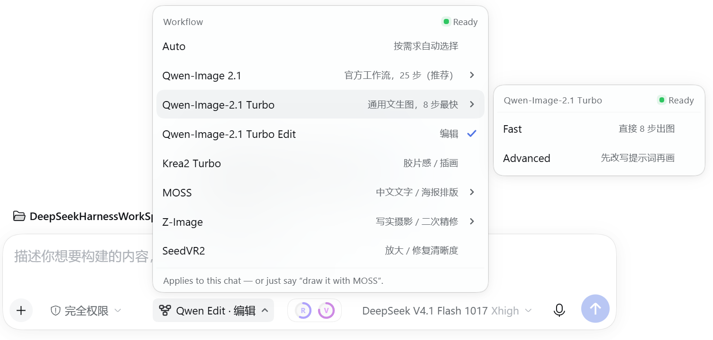

# dsh-comfyui-use

中文 · [English](README.en.md)

> 让 **DeepSeek Harness** 在对话里调用你本机 ComfyUI 画图：
> 输入框里选工作流，聊天框里出绘图动画，出图后直接在正文里看到。
> ComfyUI 只在真正画图时后台启动，空闲自动关停省显存。

- 🎛 **默认只有一个工作流**：ComfyUI 官方的 **Qwen-Image 2.1**，两个变体——文生图 / 图片编辑，
  只要一套三件套权重（int8 量化，约 7–9 GB）。
- 🧩 **能用你自己的**：本机 ComfyUI 里已经有能跑的工作流时，先劝你导入（`comfyui_import`），
  而不是让你去下我这套模型；导入后自动找出提示词/种子/尺寸/保存前缀的位置。
- 📦 **可选：旧打包的六个工作流**（Qwen Turbo 快速/进阶、Qwen Turbo Edit、Krea2、MOSS、Z-Image、SeedVR2）。
  它们依赖另一套模型，只有 `comfyui_check` 确认模型齐全后才会启用，否则选择器里是灰的。
- 🧠 **内置提示词 skill**：`comfyui-workflow-prompts`，按每个模型的脾气写提示词（含"需求太短先提问"、
  "专有角色名先联网查形象"、"至少两张参考图融合"、"出图前先交提示词"等规则）。
- 🔌 **零外部依赖**：宿主机只用 Node 内置模块；不装 Python 包、不调外部 API。
- 🧹 **只碰自己的进程**：只关「自己启动、监听本插件端口、命令行像 ComfyUI」的那个进程。
- 🩺 **`comfyui_check` 体检**：缺哪些自定义节点、缺哪些模型文件，一次列清楚。

> ⚠️ 目前只支持 **Windows 10/11**（后台启停与进程识别依赖 PowerShell）。
> macOS / Linux 可以连已经开着的 ComfyUI（把 `autoStartComfy` 设为 `false`），但不会自动启停。

---

## 安装

### 方式一：plugin_manager

在本机把仓库 clone 下来后，让 DSH 的插件管理器安装这个目录：

```
plugin_manager install_bundle  target = link:<仓库绝对路径>
```

安装后**重启 DSH 程序**（或让插件管理器热重载宿主模块），然后刷新页面。

### 方式二：手工

1. 把仓库放到任意目录，例如 `%USERPROFILE%\.dsh\plugins\dsh-comfyui-use`。
2. 在 profile 的 `package.json`（`%USERPROFILE%\.dsh\profiles\desktop\package.json`）：
   - `dependencies` 里加 `"dsh-comfyui-use": "link:C:/Users/<你>/.dsh/plugins/dsh-comfyui-use"`
   - `dsh.profile.bundles` 数组里加 `"dsh-comfyui-use"`
3. 在 profile 目录 `pnpm install`（或手工建一个指向插件目录的 junction 到 `profile/node_modules/dsh-comfyui-use`）。
4. 重启 DSH，刷新页面。

> 客户端代码是 `lib/client.js`，DSH 启动时直接读原始文件，**没有构建步骤**；改完刷新页面就生效。

---

## 第一次用：先体检（会给你下载链接）

装好后先让助手跑一次：

```
comfyui_check
```

它会告诉你三件事：

1. ComfyUI 在不在线、缺哪些**节点类**（缺就用 ComfyUI-Manager 装上）；
2. 缺哪些**模型文件**——每一份都带 **魔搭（ModelScope）下载链接**和"该放到哪个目录"；
3. 本机 ComfyUI 里**已有的工作流**里，哪些可以直接用（`localCandidates` 里 ✓ 的）。

如果第 3 条有能用的，助手会先问你："要不要用你自己的工作流？"——要的话它调 `comfyui_import`
把那个 JSON 转成 API 接进来，之后就不用下我这套模型了。

---

## 需要什么

### 1. ComfyUI

- 官方桌面版、Windows 便携版、或源码版都行。
- 插件按这个顺序找它：
  1. 配置里的 `comfyRoot` / `comfyPython` / `comfyMainPy`；
  2. 环境变量 `COMFYUI_ROOT`（或 `COMFYUI_PATH`）；
  3. 常见路径：`~/ComfyUI`、`C:\ComfyUI`、`D:\ComfyUI`、`C:\ComfyUI_windows_portable\ComfyUI`……
- 找不到也能用：你自己先开着 ComfyUI，把 `comfyUrl` 指过去即可。

### 2. 模型

**默认工作流（Qwen-Image 2.1）只要三个文件**，都在魔搭
[Comfy-Org/Qwen-Image-2.1](https://modelscope.cn/models/Comfy-Org/Qwen-Image-2.1)：

| 放到 `ComfyUI/models/...` | 文件 | 体积 |
| --- | --- | --- |
| `diffusion_models/` | `qwen_image_2.1_int8_convrot.safetensors` | ~7 GB |
| `text_encoders/` | `qwen3vl_8b_int8_convrot.safetensors` | ~8 GB |
| `vae/` | `qwen_image_2.1_vae_bf16.safetensors` | ~250 MB |

下载地址形如：
`https://modelscope.cn/models/Comfy-Org/Qwen-Image-2.1/resolve/master/diffusion_models/qwen_image_2.1_int8_convrot.safetensors`
（`comfyui_check` 会把这三条逐文件列出来，直接点或复制即可。）

> 想用 bf16 原版也行：把文件名换成同目录下的 `qwen_image_2.1_bf16.safetensors` 等，
> 并在配置里改工作流或用助手重新导出一份。

### 2b. 旧打包工作流的模型（可选）

只有你想用那六个旧工作流时才需要。工作流 JSON 里写的是**这些具体文件名**（多数是 int8 / convrot 量化版，普通 fp16 版不一定能直接替换）：

| 工作流 | 需要的文件（放在 `models/` 对应子目录） |
| --- | --- |
| Qwen-Image 2.1 Turbo 生图（快速） | `qwen_image_2.1_turbo_int8_convrot.safetensors`（unet）、`qwen3vl_8b_bf16.safetensors`（clip, type=qwen_image）、`qwen_image_2.1_vae_bf16.safetensors`（vae） |
| Qwen-Image 2.1 Turbo 生图（进阶） | 同上，另加 `qwen3.5_9b_qwen_image_2.1_pe_t2i.int8_convrot.safetensors`（clip） |
| Qwen-Image 2.1 Turbo Edit | 同"快速"三件套 |
| Krea2 Turbo | `krea2_turbo_int8_convrot.safetensors`、`qwen3vl_4b_fp8_scaled.safetensors`（type=krea2）、`qwen_image_vae.safetensors`；可选 LoRA `krea2_darkbrush.safetensors` |
| MOSS | `moss_image_sft_bf16.safetensors`、`qwen3.5_9b_int8_convrot.safetensors`（type=moss_image）、`flux2-vae.safetensors` |
| Z-Image | `z_image_turbo_bf16.safetensors`、`ae.safetensors`、`qwen_3_4b.safetensors`（type=lumina2）、LoRA `Kook_Zimage_瑶光.safetensors` |
| SeedVR2 | `seedvr2_7b_int8_convrot.safetensors`、`seedvr2_ema_vae_fp16.safetensors` |

> 没有同款模型也没关系：这些 API 图是按节点 id 打补丁的，换模型需要改 `lib/index.js` 里对应
> `patch()` 的 `unet_name`/`clip_name` 等字段（或重新导出你自己的 API 工作流）。

### 3. 自定义节点

**默认的 Qwen-Image 2.1 工作流不需要任何第三方节点**（官方模板 + 官方节点）。

旧打包的六个工作流才需要下面这些（用 ComfyUI-Manager 搜仓库名安装）：

- `rgthree-comfy`（Seed / Label）
- `ComfyUI_Comfyroll_CustomNodes`（CR LoRA Stack）
- `comfyui_layerstyle`（`LayerUtility: ImageScaleByAspectRatio V2`）
- `comfyui-easy-use`（`easy cleanGpuUsed`）
- `comfyui-kjnodes` / `RES4LYF`（部分采样/工具节点）
- `ComfyUI-Spectrum-MOSS`（`SkipLayerGuidanceDiTSimple`）
- `seedvr2_videoupscaler`（`SeedVR2Preprocess` / `SeedVR2PostProcessing` / `SeedVR2Conditioning`）
- `comfyui-impact-pack`（可选，`PreviewAny` 之类）

体检报告里的"缺节点类"就是缺这些包。

---

## 配置

安装时写进 profile 的默认值在 `cordis.patch.yml`；**你机器自己的路径不要写在那里**，写到：

```
%USERPROFILE%\.dsh\dsh-comfyui-use-config.json
```

仓库里有一份 `dsh-comfyui-use-config.example.json`，复制过去改成自己的路径即可（不想手写就只填 `comfyRoot`，其余留空自动推）。

优先级：`内置默认值` ← `这个本地文件` ← `profile/bundle 传入的 config`。

| 键 | 说明 |
| --- | --- |
| `port` | ComfyUI 端口，默认 `18189`；被别的程序占用会自动往后试 |
| `comfyUrl` | 完整地址；留空 = `http://127.0.0.1:<port>` |
| `comfyRoot` | ComfyUI 目录（含 `main.py`）；留空自动探测 |
| `comfyPython` / `comfyMainPy` / `comfyWorkdir` | 自动启动用的三件套；留空按 `comfyRoot` 推 |
| `comfyArgs` | 额外启动参数（数组） |
| `modelPathsYaml` | ComfyUI Desktop 的模型路径 yaml |
| `inputDir` / `sharedOutputDir` | 让 ComfyUI 用统一的 input/output（可选） |
| `outputDir` | 成品落盘目录，默认 `~/Pictures/dsh-comfyui` |
| `idleShutdownMs` | 空闲多久关停，默认 `60000`（1 分钟），`0` = 永不关 |
| `warmupOnLoad` | 启动 DSH 时是否顺手拉起 ComfyUI，默认 `false` |
| `autoStartComfy` | 画图时是否允许自动启动，默认 `true` |
| `workflow` | 界面默认选中的工作流，`auto` = 自动挑 |

示例：

```json
{
  "port": 18189,
  "comfyRoot": "D:\\ComfyUI",
  "outputDir": "D:\\pictures\\dsh"
}
```

---

## 界面



> 选择器在输入框里、跟模型选择器同一排；带 `›` 的家族悬停（或按 `→`）展开右侧浮层选变体。
> 这张截图来自一台六个旧工作流都已体检齐全的机器；新装的机器上它们会先灰着，等 `comfyui_check` 确认模型。

- **输入框右侧**：工作流选择器，跟模型选择器同一排。点开是分组菜单：带 `›` 的是有变体的家族，
  鼠标悬停（或按 `→`）在旁边弹出二级浮层选变体；`Esc` / 点空白处收起。
- 选中的工作流是**这个会话的指定**：助手不会再偷偷传别的 workflow 覆盖它（除非你当场点名要换）。
- 画图时，输入框上方出现一条窄进度条（阶段 + 秒数）；出图后结果**只走聊天正文**的 Markdown 图片，
  不额外占一块面板。
- 出图前助手会先把这次用的完整提示词写给你看，再开始画。

---

## 工具

### `comfyui_draw`

| 参数 | 说明 |
| --- | --- |
| `prompt` | 画面描述（必填） |
| `workflow` | 只有你在这条消息里点名了才填；界面选中的优先 |
| `override_ui` | 确实要覆盖界面选择时才传 `true` |
| `variant` | 默认工作流：`t2i`（文生图）/ `edit`（编辑）；旧工作流：`fast`/`advanced`、`double`/`single`、`refine`/`single` |
| `size` | `1:1` `3:4` `4:3` `2:3` `3:2` `9:16` `16:9` `21:9` |
| `megapixels` / `seed` / `negative` | 总像素、种子、负面（只有 MOSS 的 cfg 吃负面） |
| `reference` / `references` | 本地参考图（编辑/超分用，最多 4 张） |
| `reference_url` / `reference_urls` | 参考图网络地址，**只允许公网 http(s)**，最多 4 张，单张 ≤ 30MB |
| `scale` / `lora` / `refine` | SeedVR2 倍率、Krea2 的 LoRA 与提示词扩写 |

### `comfyui_check`

无参数。返回在线状态、缺的节点类、缺的模型文件（带魔搭链接与目标目录）、逐工作流结论，
以及**本机已有的 ComfyUI 工作流**里哪些能直接用。不启动 ComfyUI、不改配置。

### `comfyui_import`

| 参数 | 说明 |
| --- | --- |
| `file` | 工作流 JSON 的绝对路径（`ComfyUI/user/default/workflows/xxx.json`） |
| `label` | 可选显示名，默认用文件名 |

UI 格式会自动转成 API（跳过静音节点、展开 Reroute/PrimitiveNode），并推断提示词、种子、尺寸、
保存前缀的位置；识别不到提示词节点会直接报错。加入后的 id 是 `local:<文件名>`，可以当
`comfyui_draw` 的 `workflow` 用，也会出现在选择器里（标记为本机导入）。

---

## 用你自己的工作流

```text
用户：我本机 ComfyUI 里有一套我调好的工作流，能用吗？
助手：先 comfyui_check → 看到 localCandidates 里 ✓ 的那条 → 问你要不要导入
      → comfyui_import file="C:/.../user/default/workflows/xxx.json"
      → 之后直接说"用我那个 xxx 画一张……"
```

导入记录存在 `%USERPROFILE%\.dsh\dsh-comfyui-use-workflows.json`，重装插件不会丢。

---

## 进程管理（Windows）

- 启动：PowerShell `Start-Process -WindowStyle Hidden` 调 `python.exe -s main.py`（**不能用 pythonw**）。
- 关停：只有同时满足「空闲超时 + 在线 + 队列空 + 认出进程」才 `Stop-Process`。
- 识别：`Get-NetTCPConnection` 找端口的 PID，再用 `Get-CimInstance Win32_Process` 核对命令行
  含 `comfy` 且有 `main.py`；核不上就绝不杀（宁可留着，也不误杀别人的进程）。
- 端口被占：自动试 `port+1 … port+9`，并同步更新 `comfyUrl`。

---

## 安全说明

- `reference_url` 会由**宿主机去下载**，所以只允许公网 http/https，并拒绝解析到
  本机/局域网/链路本地/保留地址的域名与重定向结果；只接受 `image/*`，单张上限 30MB，落盘在系统临时目录。
- 状态端点 `/api/comfyui-use/status.json` 只响应回环地址的请求。
- 本仓库不含任何模型权重或节点代码；工作流里出现的模型/作者名仅用于描述图结构。

---

## 排错

| 现象 | 多半是 |
| --- | --- |
| `没找到 ComfyUI 的 main.py` | 配 `comfyRoot` 或设 `COMFYUI_ROOT` |
| 选择器里旧工作流是灰的 | 那六套模型不全；用 `comfyui_check` 看缺什么，或改用默认 Qwen-Image 2.1 / 导入自己的工作流 |
| 启动后 240 秒没就绪 | python 路径不对、模型/节点加载报错（看 ComfyUI 日志）、端口被防火墙拦 |
| `节点校验失败 … Value not in list` | 缺模型文件，跑 `comfyui_check` 看缺哪个 |
| `class_type not found` / 缺节点类 | 缺自定义节点包，按体检清单装 |
| 画完不出图、`/queue` 一直忙 | 上次任务卡住：重启 ComfyUI，或等空闲自动关停 |
| 界面里看不到选择器 | 没刷新页面；或 DSH 版本与插件槽位不兼容 |
| 出图很慢（首次） | 第一次要加载模型 + 编译，之后会快很多 |

---

## License

MIT。第三方模型、LoRA、自定义节点遵循各自上游许可。
